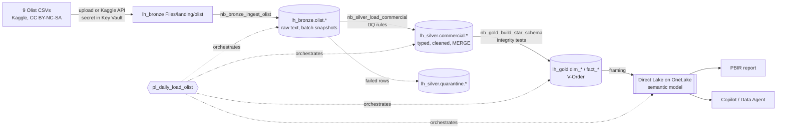
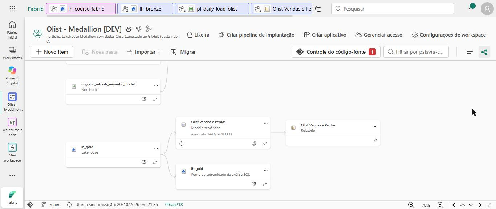
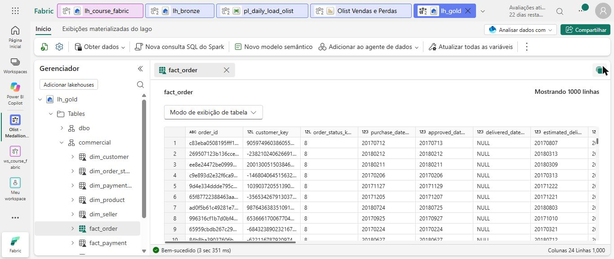
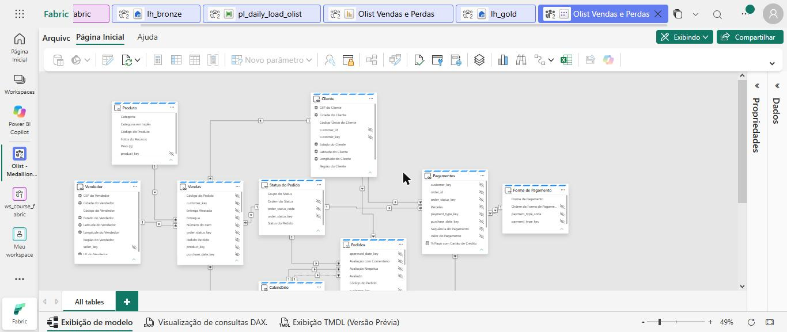

# Medallion Lakehouse on Microsoft Fabric: e-commerce revenue leakage

[🇧🇷 Português](README.md) · 🇺🇸 English

End-to-end **Microsoft Fabric** project: public e-commerce data ingested into **Bronze**, cleaned and quality-checked in **Silver**, modeled as a **star schema** in **Gold** with PySpark notebooks, and served by a **Direct Lake semantic model** versioned as **PBIP/TMDL** and prepared for **Copilot**. Everything lives in Git and is promoted through **deployment pipelines** (DEV → TST → PRD).

The semantic layer is in Brazilian Portuguese (the business audience) with an **en-US translation** for tables and measures; the technical layers (lakehouses, tables, columns, notebooks) are in English.

---

## Business problem

[Olist](https://www.kaggle.com/datasets/olistbr/brazilian-ecommerce) is a Brazilian marketplace connecting small merchants to large sales channels. The public dataset has **~100k orders (Sep/2016 to Oct/2018)** with real (anonymized) items, payments, deliveries and customer reviews.

In online retail, loss is not only shrinkage: it is **revenue that never materializes** and **customers who do not come back**. The project answers:

1. **How much revenue is lost** to canceled or unavailable orders, and in which categories?
2. **What is the delivery service level**: how many orders arrive after the promised date, where, and from which sellers?
3. **Do late deliveries hurt satisfaction?** Average review score on time vs. late.
4. **How heavy is freight** relative to product value, by region?

| KPI | Measure (pt-BR / en-US) | Rule |
|---|---|---|
| Lost revenue | `Receita Perdida` / *Lost Revenue* | Product + freight of *Canceled* or *Unavailable* orders |
| Service level | `% Pedidos Atrasados` / *% Late Orders* | Delivered after the estimated date; base = delivered orders |
| Satisfaction | `Nota Média de Avaliação` / *Average Review Score* | Score 1-5; negative = 1 or 2 |
| Logistics cost | `% Frete sobre Produtos` / *% Freight over Product* | Freight / product value |

## Architecture

| Layer | Item | Content | Load pattern |
|---|---|---|---|
| Bronze | `lh_bronze.olist` | 9 tables, all columns as string, `dp_` lineage columns | Append per batch, partitioned by ingestion date, idempotent `replaceWhere` |
| Silver | `lh_silver.commercial` | 8 clean, typed entities (`sales_order`, `customer`, ...) | `MERGE` on natural key with `dp_row_hash` change detection |
| Gold | `lh_gold.commercial`, `lh_gold.shared` | 6 dimensions, 3 facts | Overwrite, only after integrity and reconciliation tests pass |
| Semantic | `Olist Vendas e Perdas` | Direct Lake on OneLake, ~45 DAX measures | Framing at the end of the pipeline |

## Modeling decisions

Architecture Decision Records in [`docs/decisions`](docs/decisions) (Portuguese):

- **One lakehouse per layer** with schemas per source system/domain. Notebooks have **no default lakehouse**: OneLake paths are resolved from the lakehouse name in the running workspace, so the same code runs in DEV, TST and PRD with no deployment rules.
- **Three facts at their natural grain** (order item, order as an accumulating snapshot, payment) sharing conformed dimensions, instead of one wide fact that would double-count orders and reviews. Delivery flags are copied to the item fact so lateness can be sliced by seller and category without fact-to-fact relationships.
- **`BIGINT` surrogate keys from `xxhash64`** of the natural key (stable across full reloads, collisions checked on every run), an **unknown member `-1`** in every dimension, and nullable optional date keys so the calendar stays contiguous for time intelligence.
- **"What counts as a loss" lives in one place**: the Gold status dimension groups statuses into *Completed / In progress / Lost*; DAX only consumes it.
- **Idempotent, traceable loads**: the pipeline `RunId` becomes `dp_batch_id` in every layer, in the run log and in data-quality results.
- **Direct Lake on OneLake** (no silent DirectQuery fallback), V-Order writes and weekly `OPTIMIZE → reframe → VACUUM`. A Semantic Link notebook **rebinds the model** to the Gold lakehouse of whatever workspace it runs in, then triggers framing.

## AI-ready semantic model

- Business names, **descriptions on every table, visible column and measure** (grain, unit, exclusions), hidden technical keys, `summarizeBy: none` on codes, sort-by columns, geographic data categories, marked date table, implicit measures discouraged.
- Measures in display folders with PY, PM, Δ% and YTD variants of the main KPIs; explicit `DIVIDE`, `KEEPFILTERS`, `USERELATIONSHIP`.
- Copilot kit in [`docs/copilot`](docs/copilot): AI instructions with a business glossary, verified answers and 15 test questions.

## Data quality

Rules are declared in code (`DqRule` with `error` / `warn` severity), results go to `lh_silver.framework.dq_result`, failed rows to `lh_silver.quarantine.*`, and Gold is only published when it reconciles with Silver. See [`docs/data-quality.md`](docs/data-quality.md).

## CI/CD

The DEV workspace is connected to this repository (folder `/fabric`) through **Fabric Git integration**; TST and PRD receive content only through a **deployment pipeline**. See [`docs/cicd.md`](docs/cicd.md).

## How to reproduce

1. Fork this repository.
2. Create a workspace on a Fabric capacity (trial or F-SKU).
3. *Workspace settings → Git integration → GitHub*: your fork, branch `main`, folder `/fabric`, *Connect and sync*.
4. Download the [Olist dataset](https://www.kaggle.com/datasets/olistbr/brazilian-ecommerce) and upload the 9 CSVs to `lh_bronze` → *Files* → `landing/olist/` (or set `download_from_kaggle = True` with Kaggle credentials in Azure Key Vault).
5. Open `pl_daily_load_olist`, check each notebook activity points to the workspace notebook, and **Run**.
6. Open the **Olist Vendas e Perdas** report, or `fabric/Olist Vendas e Perdas.pbip` in Power BI Desktop.

## Screenshots

First end-to-end run on a Fabric trial capacity, with the workspace connected to this repository through Git integration.

**"Perdas no E-commerce" report** on the Direct Lake model: BRL 15.8M gross revenue, 0.7% lost to cancellations and unavailability, 6.8% of delivered orders late, and the average review score drops from ~4.3 (on time) to ~2.3 (late).

**`pl_daily_load_olist`**: Bronze, Silver, Gold, then model rebind and framing. The first Gold attempt hit the trial capacity's concurrent Spark session limit (HTTP 430) and the activity retry handled it.

| Lineage | Gold lakehouse schemas | Semantic model |
|---|---|---|
|  |  |  |

## License and data

Code under [MIT](LICENSE). Data is **not** included: the *Brazilian E-Commerce Public Dataset by Olist* is distributed on Kaggle under [CC BY-NC-SA 4.0](https://creativecommons.org/licenses/by-nc-sa/4.0/).

---

**Daniel Resende** · Analytics Engineer · [Portfolio](https://danielresende23.github.io/Portfolio) · [LinkedIn](https://www.linkedin.com/in/daniel-resend/)
