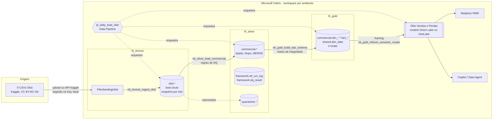
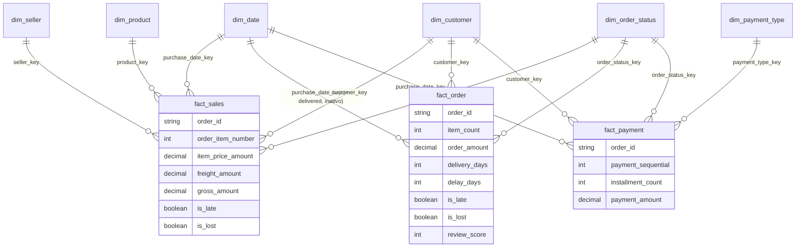
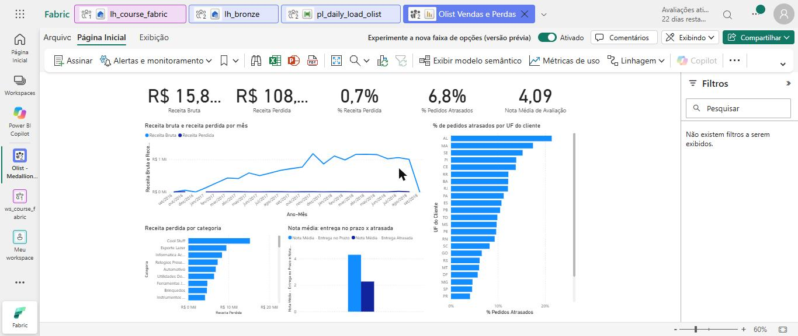
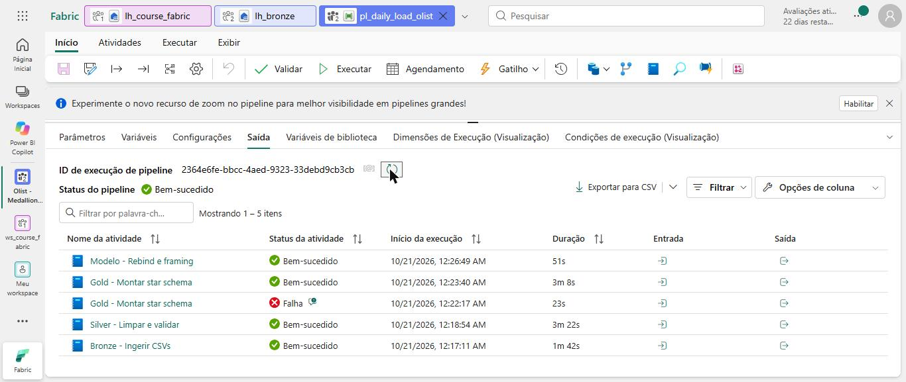

# Lakehouse Medallion no Microsoft Fabric: perdas no e-commerce

🇧🇷 Português · [🇺🇸 English](README.en.md)

Projeto de ponta a ponta no **Microsoft Fabric**: ingestão de dados públicos de e-commerce em **Bronze**, limpeza e qualidade em **Silver**, **star schema** em **Gold** com notebooks PySpark, e um **modelo semântico Direct Lake** versionado em **PBIP/TMDL**, preparado para o **Copilot**. Tudo versionado no Git e promovido por **deployment pipelines** (DEV → TST → PRD).

Faz parte da série *Além do Dashboard*, sobre perdas no varejo: aqui, quanto um marketplace perde com pedidos cancelados, itens indisponíveis e entregas atrasadas.

---

## Problema de negócio

O [Olist](https://www.kaggle.com/datasets/olistbr/brazilian-ecommerce) é um marketplace brasileiro que conecta lojistas a grandes canais de venda. O dataset público tem **~100 mil pedidos (set/2016 a out/2018)** com itens, pagamentos, entregas e avaliações reais (anonimizadas).

No varejo on-line a perda não aparece só como estoque: aparece como **venda que não se concretiza** e como **cliente que não volta**. O projeto responde:

1. **Quanto da receita se perde** em pedidos cancelados ou indisponíveis, e em quais categorias?
2. **Qual o nível de serviço de entrega**: quantos pedidos chegam depois da data prometida, onde e com quais vendedores?
3. **O atraso derruba a satisfação?** Nota média de avaliação no prazo x atrasado.
4. **Quanto pesa o frete** sobre o valor do produto, por região?

| KPI | Medida | Regra |
|---|---|---|
| Receita perdida | `Receita Perdida`, `% Receita Perdida` | Produto + frete de pedidos *Cancelado* ou *Indisponível* |
| Nível de serviço | `% Pedidos Atrasados`, `Atraso Médio (dias)` | Entregue depois da data prevista; base = pedidos entregues |
| Satisfação | `Nota Média de Avaliação`, `% Avaliações Negativas` | Nota 1 a 5; negativa = 1 ou 2 |
| Custo logístico | `% Frete sobre Produtos` | Frete / valor dos produtos |

## Arquitetura



| Camada | Item | Conteúdo | Padrão de carga |
|---|---|---|---|
| Bronze | `lh_bronze.olist` | 9 tabelas, colunas como texto, metadados `dp_` | Append por lote, partição por data de ingestão, `replaceWhere` idempotente |
| Silver | `lh_silver.commercial` | 8 entidades limpas e tipadas (`sales_order`, `customer`, ...) | `MERGE` por chave natural com `dp_row_hash` |
| Gold | `lh_gold.commercial`, `lh_gold.shared` | 6 dimensões e 3 fatos | Overwrite após testes de integridade e reconciliação |
| Semântica | `Olist Vendas e Perdas` | Direct Lake on OneLake, ~45 medidas DAX | Framing no fim do pipeline |

## Modelo dimensional (Gold)



| Tabela no modelo | Gold | Grão |
|---|---|---|
| Vendas | `commercial.fact_sales` | Item de pedido |
| Pedidos | `commercial.fact_order` | Pedido (snapshot acumulado do ciclo) |
| Pagamentos | `commercial.fact_payment` | Pagamento do pedido |
| Calendário | `shared.dim_date` | Dia |
| Cliente, Vendedor, Produto, Status do Pedido, Forma de Pagamento | `commercial.dim_*` | 1 linha por membro + desconhecido (`-1`) |

## Decisões de modelagem

Registradas como ADRs em [`docs/decisions`](docs/decisions):

- [**0001**](docs/decisions/0001-lakehouse-por-camada.md) Um lakehouse por camada, com schemas por sistema/domínio; notebooks sem lakehouse padrão, com caminhos OneLake resolvidos no workspace em execução (o mesmo código roda em DEV, TST e PRD).
- [**0002**](docs/decisions/0002-modelagem-gold.md) Três fatos em grãos diferentes (item, pedido, pagamento) com dimensões conformadas; chaves `BIGINT` por `xxhash64`; membro `-1`; status agrupado em *Concluído / Em andamento / Perdido* na Gold, para a regra de perda existir em um lugar só.
- [**0003**](docs/decisions/0003-cargas-e-idempotencia.md) Cargas idempotentes e rastreáveis: o `RunId` do pipeline vira `dp_batch_id` em todas as camadas, no run log e no resultado de DQ.
- [**0004**](docs/decisions/0004-direct-lake-on-onelake.md) Direct Lake on OneLake (sem fallback silencioso para DirectQuery), V-Order e manutenção Delta; rebind automático do modelo por ambiente via Semantic Link.

## Modelo semântico AI-ready

[`fabric/Olist Vendas e Perdas.SemanticModel`](fabric/Olist%20Vendas%20e%20Perdas.SemanticModel/definition) em TMDL:

- Nomes de negócio em pt-BR, tradução **en-US** (`cultures/en-US.tmdl`) para tabelas e medidas.
- **Descrição em toda tabela, coluna visível e medida**, com grão, unidade e exclusões.
- Chaves ocultas com nome técnico, `summarizeBy: none` em códigos e anos, `sortByColumn` em meses e dias, `dataCategory` em cidade, UF, CEP e coordenadas.
- Calendário marcado como tabela de datas, sem Auto date/time, `discourageImplicitMeasures` ligado.
- Medidas em display folders (`01 Base`, `02 Tempo`, `04 Percentuais`), variantes AA, MA, Δ% e YTD dos KPIs principais, `DIVIDE`, `KEEPFILTERS` e `USERELATIONSHIP` explícitos.
- Kit do Copilot em [`docs/copilot`](docs/copilot): AI instructions com glossário, verified answers e [15 perguntas de teste](docs/copilot/test-questions.md).

## Qualidade de dados

Regras declaradas no código (`DqRule`), resultado em `lh_silver.framework.dq_result`, linhas reprovadas em `lh_silver.quarantine.*`, e a Gold só é publicada se fechar com a Silver. Detalhes, regras e problemas conhecidos do dataset em [`docs/data-quality.md`](docs/data-quality.md).

## CI/CD

Workspace DEV conectado a este repositório (pasta `/fabric`) pela **Git integration**; TST e PRD recebem conteúdo só por **deployment pipeline**, sem regras de deployment graças ao rebind por notebook. Passo a passo e checklist de promoção em [`docs/cicd.md`](docs/cicd.md).

## Estrutura do repositório

```
fabric/                                   # pasta conectada à Git integration do Fabric
├── lh_bronze.Lakehouse/ lh_silver.Lakehouse/ lh_gold.Lakehouse/
├── nb_fw_utils.Notebook/                 # caminhos OneLake, escrita Delta, MERGE, run log, DQ
├── nb_bronze_ingest_olist.Notebook/
├── nb_silver_load_commercial.Notebook/
├── nb_gold_build_star_schema.Notebook/
├── nb_gold_refresh_semantic_model.Notebook/
├── nb_fw_maintain_tables.Notebook/       # OPTIMIZE VORDER -> framing -> VACUUM
├── pl_daily_load_olist.DataPipeline/
├── Olist Vendas e Perdas.SemanticModel/  # TMDL, Direct Lake on OneLake
├── Olist Vendas e Perdas.Report/         # PBIR, thin report
└── Olist Vendas e Perdas.pbip
docs/
├── decisions/  copilot/  img/
├── cicd.md
└── data-quality.md
```

## Como reproduzir

**Pré-requisitos:** capacidade Fabric (trial ou F-SKU), conta GitHub, Power BI Desktop (opcional, para abrir o PBIP).

1. **Fork** deste repositório.
2. Crie o workspace `Olist - Medallion [DEV]` na capacidade Fabric e habilite *Users can create Fabric items*.
3. **Git integration**: *Workspace settings → Git integration → GitHub*, aponte para o seu fork, branch `main`, pasta `/fabric`, e faça *Connect and sync*. Os lakehouses, notebooks, pipeline, modelo e relatório são criados.
4. **Dados**: baixe o ZIP do [dataset no Kaggle](https://www.kaggle.com/datasets/olistbr/brazilian-ecommerce), extraia e envie os 9 CSVs para `lh_bronze` → *Files* → `landing/olist/`.
   Alternativa: parâmetros `download_from_kaggle = True` e `key_vault_url` no `nb_bronze_ingest_olist`, com os segredos `kaggle-username` e `kaggle-key` no Key Vault.
5. Abra o **`pl_daily_load_olist`**, confirme que cada atividade aponta para o notebook do workspace e clique em **Run**. Duração típica: poucos minutos numa capacidade trial.
6. Abra o relatório **Olist Vendas e Perdas**. Para editar localmente: Power BI Desktop → abrir `fabric/Olist Vendas e Perdas.pbip` (o modelo Direct Lake é editado conectado ao serviço). O TMDL do Git traz IDs de exemplo na expressão `OneLake_Gold`: o modelo só lê dados depois que o último passo do pipeline o reaponta para o `lh_gold` do workspace.
7. Opcional: aplique o kit do Copilot (`docs/copilot/ai-instructions.md`) e rode as perguntas de teste.
8. Para TST/PRD, siga [`docs/cicd.md`](docs/cicd.md).

## Screenshots

Primeira execução completa em uma capacidade Fabric trial (workspace conectado a este repositório pela Git integration).

**Relatório "Perdas no E-commerce"** sobre o modelo Direct Lake: R$ 15,8 mi de receita bruta, 0,7% perdidos em cancelamentos e indisponibilidade, 6,8% dos pedidos entregues com atraso, e a nota média cai de ~4,3 (no prazo) para ~2,3 (atrasado).



**`pl_daily_load_olist`**: Bronze, Silver, Gold e rebind + framing do modelo. A primeira tentativa da Gold caiu por limite de sessões Spark simultâneas da capacidade trial (HTTP 430) e o retry da atividade resolveu.



Outras capturas previstas estão listadas no [README da pasta](docs/img/README.md).

## Stack

Microsoft Fabric (Lakehouse, Data Pipeline, Notebooks PySpark/Delta Lake, Direct Lake, Deployment pipelines, Git integration) · Power BI (PBIP, TMDL, PBIR, DAX) · Semantic Link · Copilot · GitHub.

## Licença e dados

Código sob [MIT](LICENSE). Os dados **não** estão neste repositório: o *Brazilian E-Commerce Public Dataset by Olist* é distribuído no Kaggle sob [CC BY-NC-SA 4.0](https://creativecommons.org/licenses/by-nc-sa/4.0/), com atribuição à Olist.

---

**Daniel Resende** · Analytics Engineer · [Portfólio](https://danielresende23.github.io/Portfolio) · [LinkedIn](https://www.linkedin.com/in/daniel-resend/)
