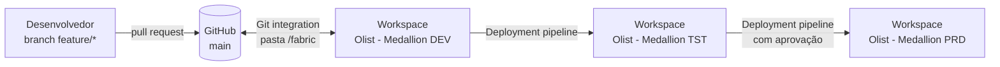

# CI/CD: Git integration e deployment pipelines

## Visão geral

| Ambiente | Workspace | Conectado ao Git | Quem altera | Dados |
|---|---|---|---|---|
| DEV | `Olist - Medallion [DEV]` | Sim, branch `main`, pasta `/fabric` | Engenharia, pelo Git ou pela interface | Amostra ou base completa |
| TST | `Olist - Medallion [TST]` | Não | Só deployment pipeline | Base completa |
| PRD | `Olist - Medallion [PRD]` | Não | Só deployment pipeline, com aprovação | Base completa |

Só o DEV fica conectado ao Git. TST e PRD recebem conteúdo exclusivamente pelo deployment pipeline: o que está em produção é sempre algo que passou por TST.

## 1. Git integration (DEV)

1. No workspace DEV: **Workspace settings → Git integration → GitHub**, conta com token fine-grained (somente este repositório, permissão *Contents: read and write*).
2. Repositório `danielresende23/fabric-lakehouse-medallion`, branch `main`, **Git folder `/fabric`**.
3. **Connect and sync**: o Fabric cria os itens a partir das pastas `<nome>.<Tipo>`:

| Pasta | Item |
|---|---|
| `lh_bronze.Lakehouse`, `lh_silver.Lakehouse`, `lh_gold.Lakehouse` | Lakehouses com schemas (só metadados; os dados não vão para o Git) |
| `nb_*.Notebook` | Notebooks PySpark (`notebook-content.py`) |
| `pl_daily_load_olist.DataPipeline` | Pipeline (`pipeline-content.json`) |
| `Olist Vendas e Perdas.SemanticModel` | Modelo Direct Lake em TMDL |
| `Olist Vendas e Perdas.Report` | Relatório PBIR |

Fluxo de trabalho:

- Mudança pequena: editar no Fabric e fazer **Commit** pelo painel *Source control*.
- Mudança revisada: criar branch, editar o TMDL/notebook localmente (Power BI Desktop, VS Code), abrir PR, fazer merge na `main` e **Update all** no workspace DEV.
- Opção para trabalho isolado: *Branch out to another workspace* cria um workspace de feature ligado a uma branch nova.

### O que fica fora do Git

- Dados (Delta, CSV): ficam no OneLake.
- Credenciais: o download opcional do Kaggle lê as chaves do Azure Key Vault.
- `.pbi/localSettings.json` e `cache.abf` do Power BI Desktop (ver `.gitignore`).

## 2. Deployment pipeline (DEV → TST → PRD)

1. **Deployment pipelines → Create pipeline** `Olist - Medallion`, com os estágios Development, Test e Production atribuídos aos três workspaces.
2. Deploy DEV → TST com todos os itens. Ordem de primeira implantação recomendada: lakehouses, notebooks, pipeline, modelo semântico, relatório (o Fabric resolve dependências quando os itens vão juntos).
3. Em TST, executar o `pl_daily_load_olist`. O último passo (`nb_gold_refresh_semantic_model`) reaponta o modelo para o `lh_gold` de TST e faz o framing.
4. Validar (checklist abaixo) e então TST → PRD.

### Por que não há regras de deployment

| Item | Como se adapta ao ambiente |
|---|---|
| Notebooks | Sem lakehouse padrão; caminhos OneLake resolvidos pelo nome do lakehouse no workspace atual (`nb_fw_utils.lakehouse_root`) |
| Modelo semântico | Expressão `OneLake_Gold` reapontada pelo `nb_gold_refresh_semantic_model` a cada execução |
| Relatório | `byPath` para o modelo; o deployment pipeline religa o relatório ao modelo do mesmo estágio |
| Pipeline | Atividades de notebook referenciam itens do mesmo workspace |

> Depois do primeiro sync ou deploy, abra o `pl_daily_load_olist` e confira se cada atividade de notebook aponta para o notebook do próprio workspace. Se alguma aparecer sem notebook, selecione-o na atividade e faça commit: a referência passa a ser mantida pelo Fabric.

### Checklist de promoção

- [ ] `pl_daily_load_olist` concluído sem erro no estágio de origem.
- [ ] `lh_silver.framework.dq_result`: nenhuma regra `error` com reprovação acima do esperado; `lh_silver.quarantine.*` revisado.
- [ ] Reconciliação da Gold aprovada (o notebook falha se não fechar).
- [ ] Modelo reenquadrado (*Refresh history* do modelo).
- [ ] Perguntas de teste do Copilot (`docs/copilot/test-questions.md`) respondidas corretamente.
- [ ] Revisão de BPA sem achados de severidade Erro.

### Lições da primeira execução (capacidade trial, 2026-10-20)

- **Configuração de tenant antes do workspace.** *Os usuários podem sincronizar itens de workspace com repositórios GitHub* vem desligada por padrão. Um workspace criado antes de ligar a opção continuou sem o provedor GitHub; recriar o workspace resolveu.
- **O sync é atômico.** Um erro de TMDL em um item (aqui, `cultures/en-US.tmdl`) impede a criação de todos. Valide o modelo antes do push (Power BI Modeling MCP `ImportFromTmdlFolder` ou Tabular Editor).
- **Atividades de pipeline religadas automaticamente.** As atividades de notebook passaram a apontar para os notebooks do próprio workspace, sem edição manual.
- **Limite de Spark da capacidade (HTTP 430 `TooManyRequestsForCapacity`).** Atividades em sequência podem esbarrar na sessão anterior ainda encerrando. O `retry: 1` com 60 s das atividades absorve isso; em capacidades pequenas, considere sessões de alta simultaneidade.
- **Reexecutar só uma atividade** gera um RunId novo: a Silver para com erro claro ("lote sem linhas na Bronze"). Rode o pipeline inteiro ou informe `batch_id` vazio no notebook para usar o último lote.

## 3. Agendamento

| Item | Agenda | Observação |
|---|---|---|
| `pl_daily_load_olist` | Diário, 06:00 (America/Sao_Paulo) | Configurado no item, em cada estágio. Agenda não é versionada no Git |
| `nb_fw_maintain_tables` | Semanal, domingo 03:00 | OPTIMIZE → framing → VACUUM |

## 4. Evolução

- Validar o TMDL em PR com Tabular Editor 2 CLI + regras BPA (GitHub Actions).
- Deploy por API (`fabric-cicd` ou REST de deployment pipelines) disparado no merge na `main`.
- Variable library para parâmetros por ambiente (ex.: pasta de landing, Key Vault).
